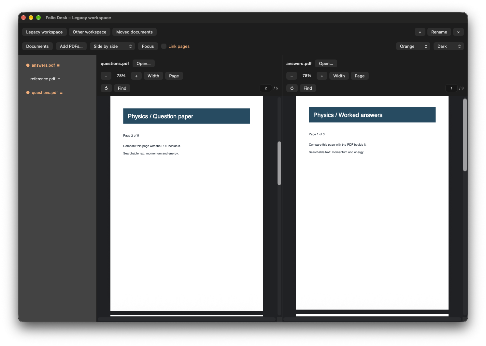

# Folio Desk

A native macOS workspace for reading PDFs side by side. Compare question papers and answers, keep references alongside your reading, and organize related documents into tabs.



Folio 0.3 uses **Apple PDFKit exclusively** for PDF display, continuous scrolling, pinch zoom, selection, and search. Rust handles PDF validation and durable session storage; Swift/AppKit provides the native interface. There is no webview, PDF.js renderer, Node runtime, LibreOffice dependency, or renderer switch.

## Install

[Download the latest release](https://github.com/justinechang39/folio-desk/releases/latest), unzip it, and move **Folio Desk.app** into **Applications**. Quit an older Folio before replacing it. Requires macOS 13.3 or newer. Published builds are Apple silicon; an Intel Mac can build its own copy using the same local script.

The app is ad-hoc signed, not notarized by Apple. For a downloaded build, macOS may require **System Settings → Privacy & Security → Open Anyway** after the first launch attempt. Automatic updates are not included.

## Reading and workspaces

- Each tab is a workspace. Use **+**, **Rename**, and **×** to manage tabs.
- Choose **Single**, **Side by side**, **Stacked**, **Three columns**, or **2 × 2**. Drag dividers to resize panes. Layout changes retain extra PDFs in the document list.
- **Add PDFs…**, a pane's **Open…** button, Finder's **Open With → Folio Desk**, or dropping files into a pane opens PDFs. Only PDFs up to 256 MB each are accepted.
- Click a document to display it in the active pane. Drag its row to a pane to swap/assign it, or to another tab to move it. Right-click a row for pane assignments, moving to another/new workspace, showing it in Finder, or removing it. Drag rows within the document list to reorder them.
- Scroll and pinch independently in each pane. Use **−/+**, **Width**, **Page**, the page-number field, and rotation controls. Zoom spans 10–800%.
- **Focus** expands the active pane; press Escape or **Focus** again to restore the layout. Clicking, pinching, or scrolling in a pane makes it active for keyboard controls.
- **Link pages** synchronizes page numbers across visible PDFs. Shorter documents stop at their last page; this does not infer corresponding content or synchronize exact scroll offsets.
- **Find** searches selectable text asynchronously, highlights matches, and provides previous/next results. It does not perform OCR on scanned pages.
- Locked PDFs show an **Unlock PDF** button. Passwords are used only in memory; switching away from a workspace can require unlocking it again.

Original PDFs are never saved over. Rotation and reading state are workspace metadata. The app is a viewer, not a PDF editor or printing application.

## Appearance

Choose **Orange** (default), **Nord**, **Dracula**, or **Solarized**, independently of **System**, **Light**, or **Dark** mode. Settings are saved. Native macOS controls retain their system appearance; palette colors apply to document backgrounds and accents. PDF page colors remain unchanged.

## Keyboard shortcuts

| Shortcut | Action |
| --- | --- |
| ⌘O | Add PDFs to the active pane |
| ⌘T | New workspace |
| ⌘W | Close workspace, with confirmation if populated |
| ⌘1–9 | Switch workspace |
| ⌘+ / ⌘− | Zoom active pane |
| ⌘0 | Fit whole page |
| ⌘F | Show/hide search in active pane |
| Escape | Restore layout from focused pane |
| ⌘Q | Save and quit |

## Session migration and privacy

Everything runs locally. No PDF uploads, telemetry, cloud services, or online fonts. PDFs are opened from their original locations; they are not copied into Folio's data folder.

Existing Folio 0.2 workspaces migrate automatically, including tabs, document paths, layouts, page, zoom, rotation, sidebar, and theme settings. The old fractional scroll offset is translated to a native page position on first open. Subsequent saves retain a native page coordinate. Missing or cloud-only PDFs stay in the workspace with a retry control instead of being removed.

Session location:

```text
~/Library/Application Support/io.github.justinechang39.foliodesk/session.json
```

Rust writes sessions atomically, retains the preceding save as `session.previous.json`, and preserves the session before the first native save as `session.before-native.json`. A damaged session is preserved and prompts before starting fresh. Nothing is written to the PDFs themselves.

The separate **Folio Native Preview** experiment is retired. It had no saved workspace, so removing it does not remove documents or settings.

## Build locally

Requirements: macOS, Xcode Command Line Tools (`xcode-select --install`), Rust stable, and Python 3. Tested with Swift 6.2 and Rust 1.98. The first Cargo dependency fetch needs internet access; normal use is offline.

```sh
git clone https://github.com/justinechang39/folio-desk.git
cd folio-desk
./scripts/package.sh
open 'dist-release/Folio Desk.app'
```

The script compiles the native Swift bridge and Rust executable, collects licenses, ad-hoc signs and verifies the app, and produces:

```text
dist-release/Folio Desk.app
dist-release/Folio-Desk-macOS-arm64.zip
dist-release/SHA256SUMS
```

On Intel, the ZIP suffix is `x86_64`. To install, quit Folio and copy the app:

```sh
python3 scripts/install-local.py
```

The installer requests a normal quit, retains a ZIP of the previous app and a session snapshot, replaces the complete bundle, and opens Folio. Add `--remove-preview` to uninstall the retired Folio Native Preview at the same time. Backups are ZIP files so they do not add Finder Open With entries.

## Local tests

```sh
cargo test --lib
python3 scripts/test-native.py
```

The native suite uses synthetic PDFs and an isolated session directory. It checks migration, all five layouts, document swaps and moves, theme changes without PDF reloads, native search and rotation, saving and actual relaunch restoration, invalid inputs, and a 1,800-step zoom/scroll workload. Original PDFs and the real user session are never modified by these tests. Use `--quick` to skip the minute-long stress run or `--skip-build` to test an existing build.

Optional local stress testing with two personal PDFs (never uploaded or committed):

```sh
python3 scripts/test-native.py --skip-build \
  --pdf '/absolute/path/first.pdf' --pdf '/absolute/path/second.pdf'
```

Reports, memory samples, and test-window screenshots (only if capture permission already exists) go into ignored `work/native-production-test/`. The benchmark suppresses App Nap only for the workload. It measures main-run-loop timer gaps, not display frame times or physical trackpad feel. The regular app retains normal macOS power behavior.

## Releases and license

Builds run locally. **GitHub Actions remains disabled**; no workflows are included. Upload the locally tested ZIP and checksum to GitHub Releases.

Folio Desk is MIT licensed. See [LICENSE](LICENSE) and [third-party notices](THIRD_PARTY_NOTICES.md). Cargo.lock pins Rust dependency versions.
